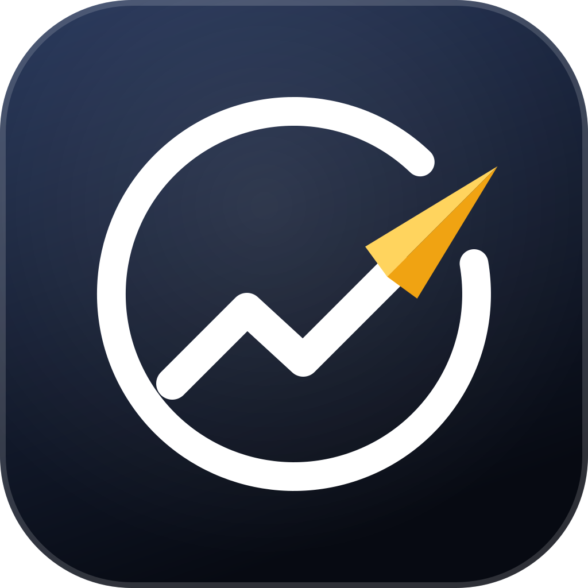

<h1 align="center">Boussole Crypto</h1>

<strong>Ton copilote d'investissement crypto.</strong> 
Des signaux expliqués, un DCA qui s'adapte au marché, des alertes qui veillent quand tu dors 
et une IA qui connaît ton dossier — pendant que tes données restent sur ton appareil.

<a href="https://github.com/Nikola17/boussole-crypto/releases/latest"><strong>Télécharger la dernière version</strong></a> 
Windows (installeur ou portable) · Android (APK)

---

## Bienvenue

Boussole est né d'une frustration connue de tout investisseur : entre les alertes de prix qu'on rate, les pépites qu'on achète trop vite et les prix qui montent quand on ne regarde pas, il manque quelqu'un pour tenir la barre. Boussole tient ce rôle — à ta place, avec tes règles, sur tes appareils.

La méthode s'inspire du projet open source [AI Berkshire](https://github.com/xbtlin/ai-berkshire) (l'esprit de Buffett, Munger, Duan Yongping et Li Lu, adapté aux cryptoactifs) : des faits sourcés plutôt que des opinions, deux côtés à chaque argument, un verdict tranché, et une thèse écrite **avant** d'acheter — pas après.

## Pour commencer (5 minutes)

1. **Télécharge** l'installeur Windows ou l'APK Android depuis la [page des versions](https://github.com/Nikola17/boussole-crypto/releases/latest). Sous Windows, SmartScreen peut signaler un « éditeur inconnu » (l'application n'est pas signée par un certificat payant) : *Informations complémentaires → Exécuter quand même*. Sous Android, autorise l'installation.
2. **Remplis ton profil investisseur** (2 minutes, 5 questions) : Boussole en déduit ton allocation cible et tes règles de risque.
3. **Ajoute une clé IA** (facultatif) dans Réglages : [Nous Portal](https://portal.nousresearch.com) pour quelques centimes par jour (DeepSeek par défaut), ou [Claude](https://console.anthropic.com/settings/keys) si tu préfères Anthropic. Une clé [CoinGecko « Demo »](https://www.coingecko.com/fr/api/pricing) gratuite accélère les pages.

À partir de la version 1.20, l'application se met à jour toute seule : le bandeau « Installer la mise à jour » télécharge et lance la nouvelle version, sur Windows comme sur Android.

Ce que tu peux faire ensuite, quand tu veux :

- **Synchroniser tes appareils** : un dépôt GitHub privé à toi, une phrase de passe, et Boussole chiffre tout (AES-256) avant de l'envoyer — GitHub ne voit jamais tes données en clair.
- **Recevoir les alertes sur Telegram**, même application fermée : un petit serveur (le code est dans `runner/`) lit la même sync chiffrée et veille pour toi, avec silence nocturne et messages regroupés le matin. Un « œil du gardien » — une GitHub Action — prévient même si le serveur tombe.

## Ce que tu y trouves

| Besoin | Réponse de Boussole |
|---|---|
| « Que faire aujourd'hui ? » | Le Cockpit : température du marché 0-100, échéances DCA, paliers de vente atteints, éparpillement, brief IA du matin |
| Acheter sans se faire avoir | Scan de sécurité on-chain (honeypot, taxes, mint, concentration, liquidité) avant tout achat de petite crypto, score de pépite, checklist anti-FOMO avec délai de 24 h |
| Ne plus rater une vente | Paliers de vente par paliers (×2, ×3, ×5…), alertes de prix, notifications Telegram application fermée |
| Savoir quoi penser | Comité de 4 analystes IA en parallèle, thèse écrite à froid, « pourquoi ça bouge ? », vérification de thèse |
| Tenir un journal honnête | Coût moyen, plus-values (fiscalité française, formule 150 VH bis), frais réels, comparaison « tout en Bitcoin », discipline du mois |
| Suivre des wallets | Adresses publiques et xpub en lecture seule (Bitcoin, EVM, Solana), wallets « smart money », pépites émergentes Solana/Base |
| Tester sans risquer | Portefeuille papier en USDC aux prix réels, thèses fantômes (« j'aurais acheté ici ») chiffrées |
| Protéger tes données | Tout sur ton appareil, verrou biométrique sur Android, secrets chiffrés par le système, aucune donnée vendue, aucune collecte |

Chaque écran explique ses indicateurs — rien n'est une boîte noire. Le portrait complet des modules (Cockpit, Signaux, Wallet, DCA, Trading, Pépites, DeFi, Airdrops, Guide) est dans [`docs/FONCTIONNALITES.md`](docs/FONCTIONNALITES.md).

## Tes données t'appartiennent

- **Aucun serveur Boussole, aucun compte.** Tes transactions, wallets et analyses vivent sur ton appareil.
- Seules sorties possibles : le dossier résumé envoyé à **ton** fournisseur IA (contenu exact visible dans Réglages — et anonymisable en un clic), les adresses publiques nécessaires pour lire tes wallets, et, si tu l'actives, ta sync chiffrée dans **ton** dépôt GitHub.
- L'application ne demande jamais de phrase secrète ni de clé privée, refuse une xprv collée par erreur, ne stocke jamais tes clés API en clair, et affiche le coût de chaque analyse IA.
- Sources de données publiques : CoinGecko, Binance, alternative.me, DefiLlama, GeckoTerminal, DexScreener, GoPlus, RugCheck, mempool.space, Jupiter et les flux RSS de la presse crypto.

---

> ⚠️ **Avertissement** — Boussole est un outil d'aide à la décision et d'éducation, pas un conseil en investissement. Aucun indicateur, aucune IA ne prédit le marché. Les cryptoactifs peuvent perdre l'essentiel de leur valeur : n'investis que ce que tu peux te permettre de perdre.

**Autres pages** : [Toutes les versions](https://github.com/Nikola17/boussole-crypto/releases) · [Historique des fonctionnalités](docs/FONCTIONNALITES.md) · [Charte du logo](branding/README.md)
