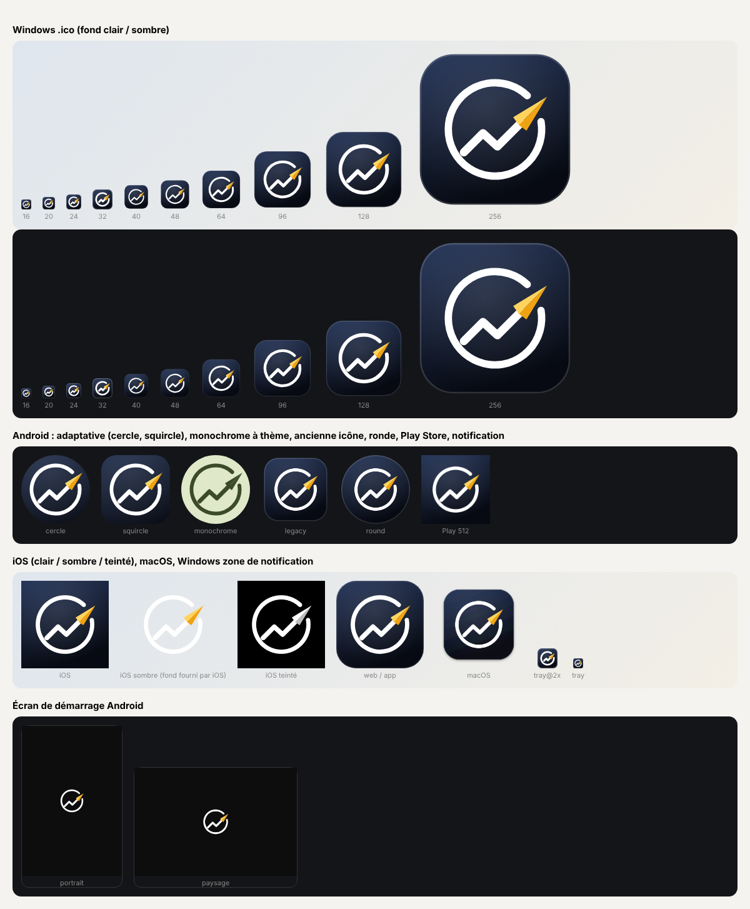

# Logo Boussole Crypto

**L'idée** : un anneau de boussole ouvert (le cadran), une courbe qui monte (le marché) et une pointe d'aiguille dorée
qui sort de l'anneau (le cap). Palette « Nuit & or » : fond bleu nuit, traits blancs, pointe or.

| Rôle | Couleur |
|---|---|
| Fond (haut → bas) | `#26365a` → `#070a12` |
| Traits | `#ffffff` |
| Pointe (facette claire / ombrée) | `#ffd45e` / `#f0a312` |
| Fond des écrans de démarrage | `#0d0d0d` |

Un liseré blanc à 16 % entoure l'icône là où sa forme est fixée (Windows, macOS, web), pour qu'elle reste visible
sur un fond sombre. En dessous de 40 px, une version simplifiée (traits plus épais, courbe plus courte) prend le relais.

## Fichiers

Tout est généré par `scripts/make-icons.cjs` (ne pas retoucher à la main : modifier le script puis le relancer).

| Où | Quoi |
|---|---|
| `svg/` | Sources vectorielles : icône, icône plein cadre, petite taille, glyphe seul (couleur et monochrome), fond |
| `ios/AppIcon.appiconset/` | iOS : 1024 px clair (sans transparence), sombre et teinté, avec `Contents.json` |
| `android/play-store-512.png` | Icône de la fiche Play Store |
| `../public/icon.svg` | Favicon et logo affiché dans l'application |
| `../build/icon.ico`, `icon.icns`, `icon.png`, `tray*.png` | Windows (16 → 256 px), macOS (16 → 1024 px), icône près de l'horloge |
| `../android/app/src/main/res/` | Icône adaptative vectorielle (fond, premier plan, monochrome pour les icônes à thème d'Android 13+), anciennes icônes, icône de notification `ic_stat_boussole`, écrans de démarrage |

## iOS

Après `npx cap add ios`, copier le contenu de `ios/AppIcon.appiconset/` dans
`ios/App/App/Assets.xcassets/AppIcon.appiconset/` (remplacer l'existant). Pour Icon Composer (iOS 26 et plus),
importer `svg/fond.svg` comme arrière-plan et `svg/glyphe.svg` comme calque.
